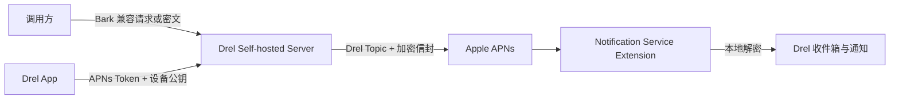

# Drel 自建加密推送服务设计

## 目标

让已发布的 Drel iOS 客户端在不自行编译 App 的前提下，允许用户部署一台
兼容 Bark 调用习惯的推送服务器。自建路径直接连接 APNs；`api.drel.app` 不参与
消息投递。消息优先在发送端加密，只有目标 iPhone 的通知扩展能够解密。服务端代封装
仅保留为 Bark 兼容的便利模式，不得被描述为对服务端运营者的端到端加密。

官方 Drel 保持零配置默认路径；自建服务器是显式添加的第二条路径，不改变已提交的
1.0 Build 60。

## 约束与非功能要求

- 保持现有 `/<deviceKey>`、`/push`、`/register` Bark 兼容接口。
- 自建服务只保存 APNs Token、Device Key、设备公钥、撤销状态和必要的去重记录；
  不保存明文或完整密文日志。
- 每次 Drel 安装都有独立 X25519 密钥对；私钥在本机并供 Notification Service
  Extension 使用。
- 仅接受 HTTPS 自建服务器；本地 HTTP 只允许 Debug/Test 构建。
- 单条可见 APNs 通知至多发送一次；超时不重试。
- Docker 是主要部署方式；单二进制 Swift Server 是次要方式。

## 架构

复用现有 `Server/` 作为模块化单体：注册、配对描述、加密信封、幂等和 APNs
发送都在同一个容器中，以减少自建用户的部署复杂度。不会新建第二个 Go 服务。

### 配对和注册

服务暴露 `/.well-known/drel-push.json`，返回协议版本、显示名称、HTTPS 基地址、
注册和推送端点、服务器签名公钥指纹。部署页面生成包含该地址和一次性配对令牌的
二维码；Drel 也支持粘贴地址。

Drel 验证 HTTPS、描述格式和服务健康状态后，在本机生成 X25519 密钥对并提交
`deviceToken`、`deviceKey`、`encryptionPublicKey` 和配对令牌。服务返回可复制的
推送 URL。二维码、响应和日志均不得含 APNs Token 或私钥。

### 加密信封

协议 `drel.push-envelope.v1` 使用 X25519 临时密钥协商、HKDF-SHA256 和
AES-256-GCM。信封含版本、消息 ID、创建/过期时间、临时公钥，以及包含
`nonce|ciphertext|tag` 的密文。发送端先通过 `GET /self-hosted/recipients/<deviceKey>` 取得目标设备的
**公开** X25519 密钥（绝不返回 APNs token），再本地生成信封并提交到 `/push`。后者使
自建服务也不能读取消息正文；该端点必须只接受 `deviceKey`、空 wrapper `title/body`
和 `drelEnvelope`。服务端代封装仅用于既有 Bark URL 的过渡兼容。

APNs 外层只带通用占位 alert、`mutable-content` 和信封。NSE 验证期限和完整性后
替换为真实内容；失败只显示通用加密通知。

### APNs 凭据边界

与 Bark 一样，自建服务器需要能向 Drel Topic 发 APNs。绝不将当前开发者团队级
`.p8` 提交到仓库或镜像。发布时只能使用专门为 Drel Topic 签发、可轮换的凭据；
在该凭据尚未由账号所有者创建前，代码和容器必须以显式环境变量引用凭据文件，
不能伪造“零配置直连 APNs”。

## 失败处理与运维

- 无效/过期配对令牌、重复 `messageId`、无效公钥、无效密文信封、超过 APNs 大小限制：
  返回受控 4xx，不投递。
- `BadDeviceToken`：删除对应注册并让客户端下次启动重新注册。
- APNs 超时：返回不确定状态，不自动重发。
- 私钥缺失或解密失败：只显示通用失败提示；不降级为明文。
- 证书到期：健康端点报告剩余天数；新镜像和受控滚动更新完成轮换。
- 数据卷必须备份；迁移只迁移公开注册信息，永不迁移设备私钥。

## 验收

1. Server 单元测试验证描述、配对、注册、幂等、明文拒绝/加密、撤销和持久化。
2. SDK 单元测试验证 X25519 信封与篡改/过期失败。
3. iOS Simulator 验证扫码/手输、服务器验证、配置保存和本地解密。
4. 独立 Docker 容器验证 `/ping`、描述、注册和假 APNs 客户端调用。
5. 只有以上通过后，才用 TestFlight 真机验证前台、后台、锁屏、点击路由和无重复发送。
