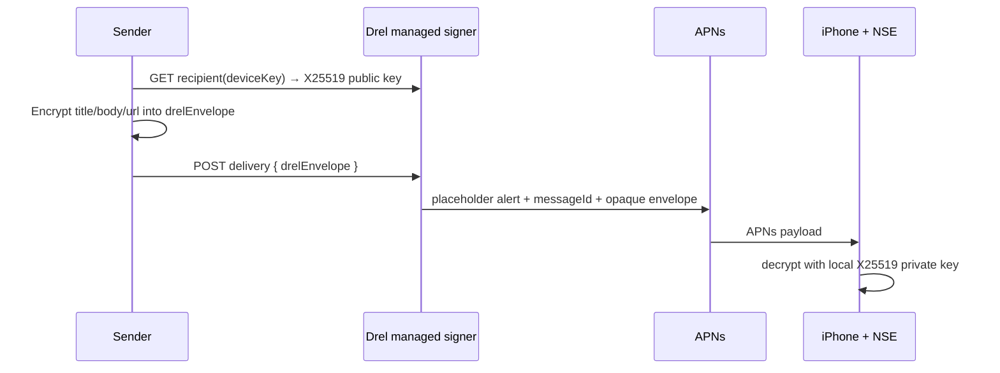

# Drel 托管加密推送：威胁模型

## Overview

本模型覆盖尚未启用的 V2 托管加密签名入口。原版 Store App 通过一次性配对注册
APNs token、随机 `deviceKey` 和 X25519 公钥；发送方只读取公钥并上传已加密的
`drelEnvelope`。托管服务使用私有的 APNs provider credential 发送不透明 payload。

| Component | Responsibility | Evidence |
| --- | --- | --- |
| Managed route | one-time enrollment, public-key discovery, strict opaque delivery, revocation | `Server/Sources/WebBridgeServer/Routes/ManagedEncryptedPushRoutes.swift:20-109` |
| Managed registry | separate device/pairing persistence from direct self-hosted service | `Server/Sources/WebBridgeServer/Configuration.swift:92-166` |
| APNs signer | rejects unavailable signer and emits only envelope delivery payload | `Server/Sources/WebBridgeServer/Services/APNsService.swift:163-189` |
| Device key | only public X25519 key is discoverable; token remains private | `Server/Sources/WebBridgeServer/Services/TokenStore.swift:61-67` |

## Assets, boundaries, and invariants

- **Message plaintext and private key:** only the sender before encryption and the paired iPhone after decryption may access them. The route accepts exactly `{drelEnvelope}` and rejects extra wrapper fields (`ManagedEncryptedPushRoutes.swift:112-129`).
- **APNs token:** required by the signer but never returned by the recipient endpoint (`ManagedEncryptedPushRoutes.swift:36-47`).
- **Provider credential:** must remain in the controlled signer deployment; it is not an API response, config import, QR payload, or repository artifact. This is an operational prerequisite, not something source code can enforce by itself.
- **Pairing authority:** a token is one use and bounded by `SelfHostedPairingStore`; the registration route consumes it before storing the target (`ManagedEncryptedPushRoutes.swift:50-81`).
- **Write capability:** `deviceKey` authorizes delivery but cannot decrypt. Revocation removes the exact token/key registration (`ManagedEncryptedPushRoutes.swift:96-109`; `TokenStore.swift:75-91`).

## Scenarios and controls

| Priority | Scenario | Existing control | Remaining requirement |
| --- | --- | --- | --- |
| High | Sender accidentally posts plaintext alongside envelope | raw JSON allow-list rejects every field except `drelEnvelope` | keep endpoint isolated from permissive Bark routes |
| High | Third party obtains provider key and forges alerts | provider key is never distributed; managed routes are off by default | host secret permissions, key rotation and Apple credential monitoring |
| Medium | `deviceKey` leaks and is abused to send spam | per-key 60/min in-memory rate limit; owner can unregister/reset | edge/WAF limits and anomaly alerting before production activation |
| Medium | Token/public key from one mode crosses into another | managed token store and pairing store are distinct files | deployer must keep direct and managed environment configuration separate |
| Medium | Signer unavailable but client reports success | the process refuses managed-route startup without a usable signer; delivery also fails closed | real APNs/TestFlight delivery acceptance before enabling |
| Low | Disk compromise reveals pairing codes | persistent pairing store records only digests | encrypt host disks and restrict service account access |

This is a source-backed architecture model, not evidence of physical APNs delivery. The mandatory remaining gate is a TestFlight device test of foreground, background, lock-screen, notification tap, exact-once delivery and revocation.
